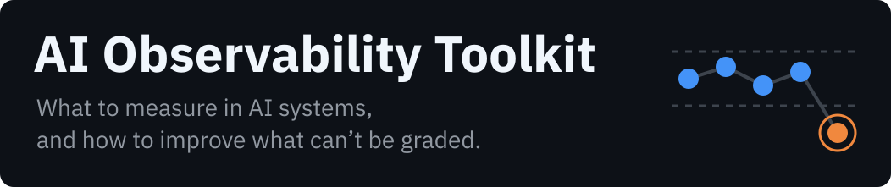

<p>
  
</p>

**Metrics and observability for AI systems, worked through real use cases: what to watch, how to read it, and what to do when no single score says whether the answer was right.**

> [!NOTE]
> **Work in progress.** 2 of 11 items are available today. The other 9 are listed below with their status, so you can see where the toolkit is going. Each available item stands on its own.

## At a glance

| | |
|---|---|
| **Goal** | Give teams that run AI systems a way to tell whether those systems are working, and to improve them when the answer is a judgment rather than a pass or fail. |
| **What it offers** | Assets for measuring and observing AI systems: reference data and framework crosswalks, data quality extended to generated output, methods for improving results that have no exact grade, and worked use cases on real systems, from privacy gates and AI search to agents. |
| **Governance** | Every framework or standard is quoted from its primary document and kept in the repository. Every judgment states its reason, and calls that could go either way are marked uncertain rather than settled. |
| **Measurement** | Every asset says what it was tested on and how many cases, and what that cannot show. Every check script is seen to catch a planted error, and to miss it when switched off, before it is trusted. |

## What's in the toolkit

Status: **available** · **next** (the next batch being built) · **planned**. Nothing marked next or planned exists yet.

### Reference

| Item | What it does | Status |
|---|---|---|
| [**Metric catalog data**](data/) | The AI Metrics Catalog's metrics as one data file (43 after the audit so far), each placed in an area of the AI system, tagged with the NIST characteristic it gives evidence for and with how it is measured | **available** |
| [**NIST AI RMF crosswalk**](crosswalk/) | Maps the metrics to the framework's four functions (Govern, Map, Measure, Manage) and shows where the framework asks for evidence no metric provides | **available** |
| Data quality dimensions for AI | Starts from the classic dimensions (accuracy, completeness, consistency, timeliness, validity) and shows what changes for each when the system's output is generated | planned |
| Metrics and business goals | Links each metric to the business question it answers, so a dashboard can be read by the people who fund the system | planned |
| Improving what can't be graded | How to make an AI system better when its output has no exact score, using the way a professional editor improves a book as the model | planned |

### Use cases

| Item | What it does | Status |
|---|---|---|
| Privacy gate | Rules or an AI model as the check that keeps personal data out of a workflow: what each can prove to an auditor, and what each misses | planned |
| AI-driven search | When a search system writes the answer itself, clicks stop measuring relevance. Information need satisfaction as the replacement, and how to rate it | planned |
| Prompt evaluation | What the [Prompt Portfolio](https://github.com/luispsalas/prompt-portfolio) measures when it tests a prompt on a fixed set, read as observability practice | planned |
| Retrieval pipeline | Retrieval quality and run logs for a local document question-answering pipeline, tested end to end | planned |
| Runtime monitoring | Security signals from a running Kubernetes cluster treated as observability data | planned |
| Agent observability | What to record when an AI agent acts on its own, and how to review it afterwards | planned |

## What this does not do (read first)

- **It is not a compliance checklist.** The NIST crosswalk shows where metrics can supply evidence for the framework. Metrics reach 26 of its 72 subcategories, and meeting it takes policies, roles and documentation as well.
- **The use cases are small.** Most run on a lab built for this purpose, not on a production system, and each will say so with its sample size.
- **The metric audit is under way.** 7 of the 43 metrics have been checked against current research so far ([`data/metric-audit.csv`](data/metric-audit.csv)); the rest still carry tool lists and target ranges from August 2026, and tools in this area change quickly.

## Why it matters

Traditional data quality and software testing assume that the same input gives the same output, so a check either passes or fails. Many AI systems break that assumption. A rule can be read, signed off and proven on a test set, while an AI judgment may answer differently tomorrow and cannot hand an auditor a list of what it will catch. Teams still need to know whether these systems work and how to make them better. This toolkit collects the metrics, the methods and the worked cases for doing that, starting with what can be shown on real systems.

## Quick start

```bash
python3 tools/test_check_data.py
```

This proves the checker works: each of its 22 rules must catch a planted error, and miss it when switched off. It should end with `ALL PASSED`. Then check the data and the crosswalk:

```bash
python3 tools/check_data.py
```

Python 3, standard library only. The data is plain CSV, so it opens in any spreadsheet. Re-extracting the framework text from the PDF (`tools/extract_nist_rmf.py`) also needs `pdftotext`.

## Repository map

```
data/       metrics.csv (43 metrics), areas.csv (6 areas), metric-audit.csv, nist-ai-rmf.csv (72 subcategories)
crosswalk/  the NIST AI RMF crosswalk: one CSV of links and a README with findings
sources/    the NIST AI RMF 1.0 and its Playbook, with citations and how their text was checked
tools/      check_data.py (22 rules) and its tests, the NIST extractor, the summary generator
assets/     the banner
```

## How it was built

Written in plain Markdown, with data in CSV. AI-assisted: an AI coding agent drafts from briefs I write, and I review and edit the result. For the crosswalk, the agent extracted the framework text, proposed every link with its reason, and wrote the checks. I review every link before it is published.

## Related concepts

From the [Applied AI Concepts](https://luispsalas.github.io/applied-ai-concepts/) wiki: [Observability](https://luispsalas.github.io/applied-ai-concepts/concepts/observability.html) · [Evaluation](https://luispsalas.github.io/applied-ai-concepts/concepts/evaluation.html) · [Determinism vs Probabilism](https://luispsalas.github.io/applied-ai-concepts/concepts/determinism-vs-probabilism.html) · [Data Quality](https://luispsalas.github.io/applied-ai-concepts/concepts/data-quality.html) · [LLM-as-Judge](https://luispsalas.github.io/applied-ai-concepts/concepts/llm-as-judge.html) · [Model/Data Drift](https://luispsalas.github.io/applied-ai-concepts/concepts/model-data-drift.html)

## License

Code (`tools/`): [MIT](LICENSE). Documents, data and examples: [CC BY 4.0](LICENSE-docs). © 2026 Luis P. Salas.
