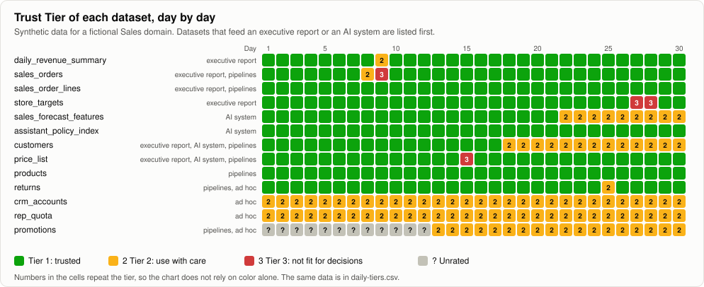
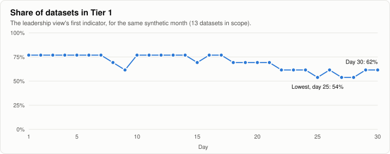

# Trust Tiers: a worked example (synthetic)

What the [Trust Tiers design](../trust-tiers.md) looks like in a reporting context: one month of a fictional Sales domain, scored every day by the design's rules, with the daily exception view, the leadership risk indicators and the history of every exception. Everything on this page is generated by [`tools/build_trust_tiers_example.py`](../../tools/build_trust_tiers_example.py) from invented data.

## What this does not do (read first)

- **The data is synthetic and the company is fictional.** The 13 datasets, their owners and the incidents were made up to exercise each rule once. No real system produced any number here.
- **It shows that the rules can run, not that they are right.** The weights and thresholds are still the design's untested starting points. A month of invented incidents cannot say whether 90 and 70 are good thresholds.
- **It counts calendar days.** The design measures escalation in business days, and a simulation without a calendar of working days cannot. The ages of open exceptions would be shorter in business days.
- **It runs every rule as written, gaps included.** Where running the rules exposed something the design does not say, the example follows the design anyway and lists the gap [at the end of this page](#what-running-it-showed-about-the-design).

## The scenario

Thirteen datasets in an invented retailer's Sales domain. Six feed an executive revenue report and four feed AI systems (a sales forecast model and a sales assistant that answers from a policy index), with some feeding both. The rest feed other pipelines or ad hoc analysis. Over the month:

- **Days 8 and 9:** two nightly loads of `sales_orders` fail. The revenue summary built on it is halted on day 9.
- **Day 15:** a blocking rule on `price_list` (no negative prices) fails after a currency conversion is applied twice.
- **Day 18:** the steward of `customers` leaves and is not replaced this month.
- **Day 22:** new stores arrive in `sales_forecast_features` without a region, so a completeness rule fails from then on.
- **Day 25:** a rule on `returns` fails because it still checks a retired status code. The data was fine: a false alarm.
- **Days 27 and 28:** the owner of `store_targets` changes role, until a new owner is named on day 29.
- **Days 1 to 12:** `promotions` is not onboarded yet, so it is Unrated.
- **All month:** `crm_accounts` has 4 of its 14 critical elements without a certified definition, and `rep_quota` has one critical element with no data quality rule.

## How the month looked

Each row is a dataset and each cell a day. Two things stand out. Most incidents are short, a day or two of yellow or red that the escalation path closes. And three rows sit in Tier 2 for most or all of the month without any incident at all. The design's daily view never shows them, which is the first finding below.

The leadership view's first indicator starts at 77% and reaches its lowest, 54%, on days 25, 27 and 28, when three exceptions are open at once on top of the three datasets that never reach Tier 1. It ends the month at 62%.

## The reports

The three tables below are generated from [`daily-tiers.csv`](daily-tiers.csv) and [`exceptions.csv`](exceptions.csv). Each reason is the one-sentence explanation the design asks for, built from the conditions the dataset fails.

<!-- GENERATED: do not edit by hand -->

### Daily exception view, day 30

| Dataset | Consumers | Tier (yesterday → today) | Reason | Protection | Exception | Escalation |
|---|---|---|---|---|---|---|
| `sales_forecast_features` | AI system | Tier 2 → Tier 2 | Tier 2 because 1 of 22 rules on critical elements failed | warn | EX-05 | 4. leadership, 8 days open (past agreed time) |
| `customers` | executive report, AI system, pipelines | Tier 2 → Tier 2 | Tier 2 because no steward assigned | warn | EX-04 | 4. leadership, 12 days open (past agreed time) |

### Leadership risk indicators, by week

| Indicator | Day 7 | Day 14 | Day 21 | Day 28 | Day 30 (today) |
|---|---|---|---|---|---|
| Datasets in Tier 1 | 10 of 13 (77%) | 10 of 13 (77%) | 9 of 13 (69%) | 7 of 13 (54%) | 8 of 13 (62%) |
| Tier 3 or Unrated, feeding an executive report or AI system | 0 | 0 | 0 | 1 | 0 |
| Exceptions open past their agreed time | 0 | 0 | 0 | 2 | 2 |
| Median days to restore (closed exceptions) | none closed yet | 1.5 | 1 | 1 | 1 |
| Datasets Unrated | 1 of 13 | 0 of 13 | 0 of 13 | 0 of 13 | 0 of 13 |
| Tier drops confirmed as real problems | none closed yet | 2 of 2 | 3 of 3 | 3 of 4 | 4 of 5 |

### Every exception this month

| Id | Dataset | Opened (day) | Closed (day) | Tier | Cause recorded at closing | Real problem? |
|---|---|---|---|---|---|---|
| EX-01 | `sales_orders` | 8 | 10 | Tier 1 → Tier 3 | Upstream order system changed its export path; load job pointed at the old one | yes |
| EX-02 | `daily_revenue_summary` | 9 | 10 | Tier 1 → Tier 2 | Halted on purpose while its source table was stale | yes |
| EX-03 | `price_list` | 15 | 16 | Tier 1 → Tier 3 | Currency conversion applied twice to one supplier file | yes |
| EX-04 | `customers` | 18 | open | Tier 1 → Tier 2 | not yet found |  |
| EX-05 | `sales_forecast_features` | 22 | open | Tier 1 → Tier 2 | not yet found |  |
| EX-06 | `returns` | 25 | 26 | Tier 1 → Tier 2 | Rule compared against a deprecated status code; rule fixed, data was fine | no |
| EX-07 | `store_targets` | 27 | 29 | Tier 1 → Tier 3 | Owner changed role; regional sales director named as the new owner | yes |

<!-- END GENERATED -->

## What running it showed about the design

Writing the rules as code and running a month through them showed where the design is specific enough and where it is not. These are proposals for the design, not changes made to it.

1. **The hard conditions work as intended.** On day 15, `price_list` scored 95.6 and still went to Tier 3, because a blocking rule failed. On every day, `rep_quota` scored 100 and stayed in Tier 2, because one critical element has no rule. A score alone would have put both in Tier 1.
2. **A dataset can sit in Tier 2 forever without anyone being told.** Exceptions open only when a tier drops, so `crm_accounts`, `rep_quota` and `promotions` (after onboarding) never appear in the daily view. They show up only as a lower Tier 1 share in the leadership view. **Proposal:** open an exception for any dataset that stays below Tier 1 for longer than an agreed time, and add "datasets below Tier 1 for more than 30 days" to the leadership indicators.
3. **Lineage is recorded but not used.** On day 9, the revenue summary was in Tier 2 while the table it is built from was in Tier 3. The design scores each dataset on its own. **Proposal:** a dataset cannot rank above the worst tier of the critical sources its lineage names.
4. **Not every exception is a data failure.** The missing steward on `customers` follows the same timetable as a failed load and reaches leadership after three days. The design does not say whether a gap in ownership should escalate on the same clock. **Proposal:** give ownership gaps their own agreed time, and decide it with the people who assign stewards.
5. **The alert-precision indicator needs months, not weeks.** After a month it rests on five closed exceptions (4 of 5 confirmed as real problems). The scorecard example revises the weights if precision stays under 70% for two months, and at this rate that rule would act on about ten verdicts. **Proposal:** state a minimum number of verdicts before the indicator is read.

## Files

| File | Holds |
|---|---|
| [`datasets.csv`](datasets.csv) | The 13 invented datasets: consumers, owner, steward, agreed lag, critical elements, rules, certified definitions, lineage |
| [`daily-signals.csv`](daily-signals.csv) | What was simulated each day: hours since the last load, rules failed, roles filled |
| [`daily-tiers.csv`](daily-tiers.csv) | What the design's rules made of it: each signal's value, the score, the tier, the protection and the reason |
| [`exceptions.csv`](exceptions.csv) | Every exception, with when it was acknowledged, its agreed time, its cause and whether it was a real problem |
| `tier-history.svg`, `tier1-share.svg` | The two charts above |

To regenerate everything: `python3 tools/build_trust_tiers_example.py`. The script checks that each scripted incident produces the tier it was written to produce, so a change to the rules that alters the example stops the build instead of quietly redrawing the charts.
